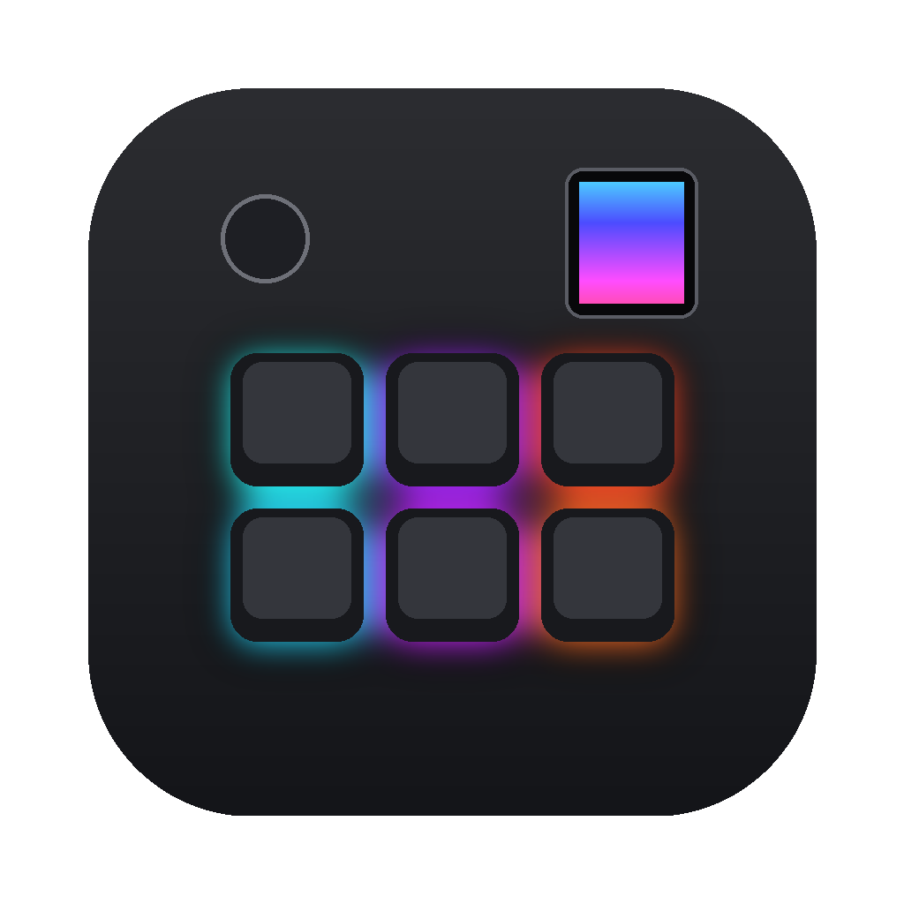
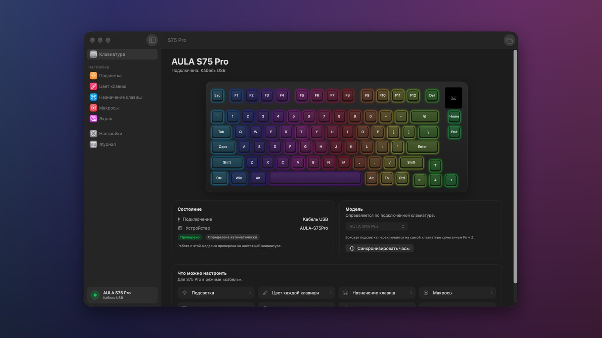
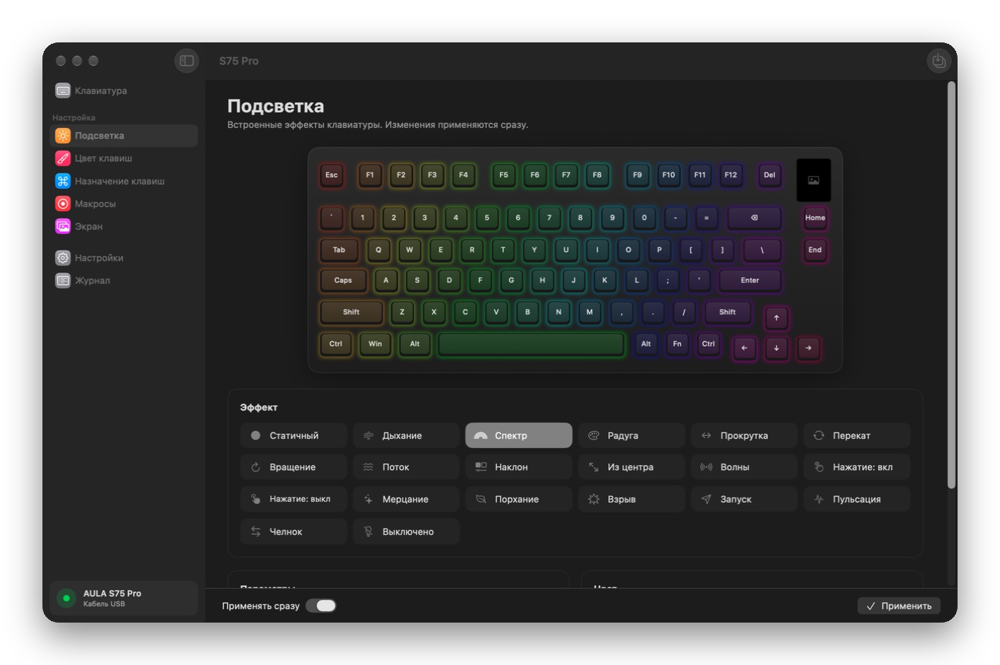
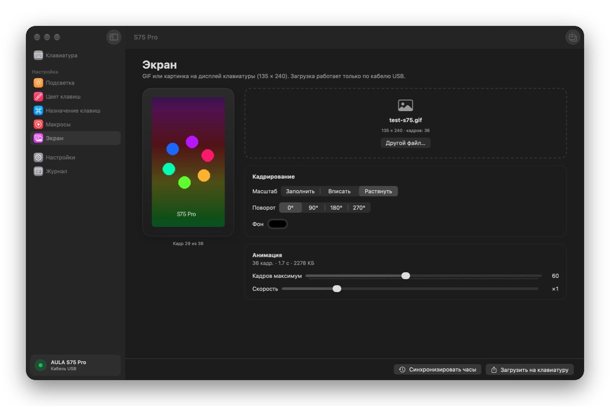
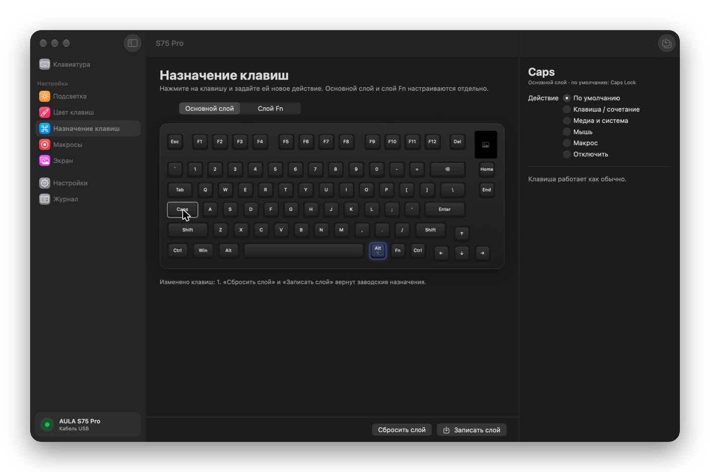
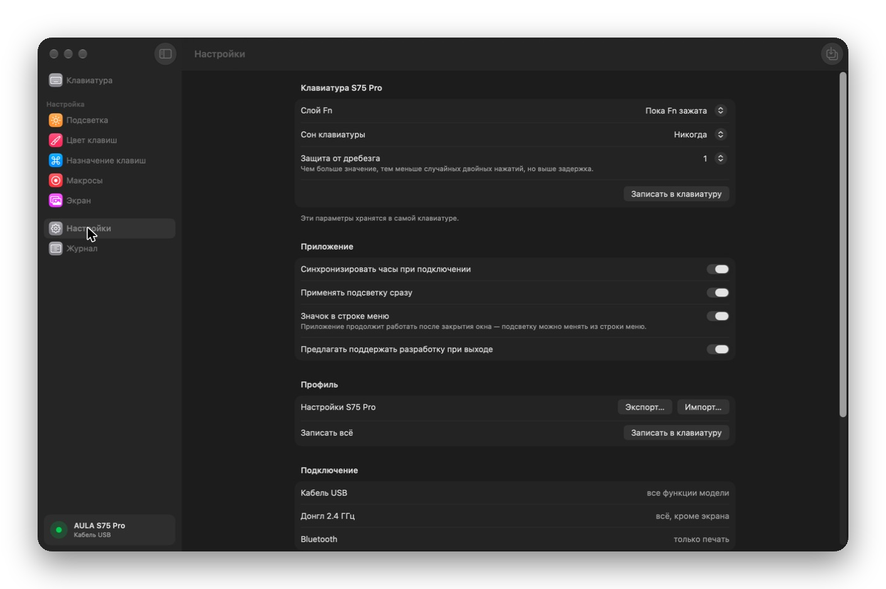

<div align="center">



# AulaControl

**Приложение для клавиатур AULA на Mac** — подсветка, цвета клавиш, переназначение, макросы и GIF на экран клавиатуры. Без Windows и виртуальных машин.

[](https://github.com/AulaControl/aula-control-mac/releases/latest)
[](https://boosty.to/xaelithh)




[Скачать](#установка) · [Модели](#поддерживаемые-модели) · [Вопросы](#частые-вопросы) · [English](#english)

</div>

---

Официальный драйвер AULA работает только на Windows. AulaControl — бесплатная нативная программа для macOS, которая делает то же самое: подключите клавиатуру кабелем, и модель определится сама.

## Возможности

| | |
|---|---|
| 🌈 **Подсветка** | все встроенные эффекты клавиатуры, яркость, скорость, направление и цвет — изменения применяются сразу |
| 🎨 **Цвет каждой клавиши** | раскрашивайте клавиши кистью прямо на схеме, заливки радугой и по рядам |
| ⌨️ **Переназначение** | основной слой и слой Fn: сочетания клавиш, медиа, кнопки мыши, макросы, отключение клавиш |
| ⏺ **Макросы** | запись нажатий в реальном времени, паузы, клики мыши, ввод текста |
| 🖼 **Экран клавиатуры** | GIF и картинки с кадрированием, поворотом и живым предпросмотром |
| 🕐 **Часы и настройки** | синхронизация часов, сон, режим Fn, защита от дребезга |
| 💾 **Профили** | свой набор настроек для каждой модели, экспорт и импорт |

<table>
<tr>
<td></td>
<td></td>
</tr>
<tr>
<td align="center">Подсветка</td>
<td align="center">GIF на экран</td>
</tr>
<tr>
<td></td>
<td></td>
</tr>
<tr>
<td align="center">Назначение клавиш</td>
<td align="center">Настройки</td>
</tr>
</table>

## Установка

1. Скачайте **AulaControl-1.0.dmg** со страницы [последнего релиза](https://github.com/AulaControl/aula-control-mac/releases/latest).
2. Откройте файл и перетащите **AulaControl** в папку **«Программы»**.
3. Приложение не подписано сертификатом Apple, поэтому при первом запуске macOS его заблокирует. Откройте **Системные настройки → Конфиденциальность и безопасность**, прокрутите вниз и нажмите **«Всё равно открыть»**. Или выполните в Терминале:
   ```bash
   xattr -dr com.apple.quarantine /Applications/AulaControl.app
   ```
4. Подключите клавиатуру **кабелем USB-C** и переведите переключатель режимов на клавиатуре в положение **USB**.

Нужна macOS 14 Sonoma или новее. Работает на Apple Silicon и Intel.

## Поддерживаемые модели

| Модель | Что работает | Статус |
|---|---|---|
| **S75 Pro** | всё: подсветка, цвета клавиш, клавиши (2 слоя), макросы, экран 135×240, часы, настройки | ✅ проверено |
| **F75 Max** | подсветка, экран 128×128, часы, настройки | 🔵 проверено сообществом |
| **F108 Pro** | подсветка, экран 240×135, часы, настройки | 🔵 проверено сообществом |
| **F75, F87, F87 Pro, F99, F99 Pro, H108** и проводные версии | подсветка, цвета клавиш (по кабелю), сон, заряд батареи | 🔵 проверено сообществом |
| **F87 Pro** новой ревизии (USB `38A6:271x`) | подсветка, цвета клавиш, клавиши, макросы, настройки | 🟠 экспериментально |

✅ — проверено в этом приложении на настоящей клавиатуре.
🔵 — протокол проверен на настоящей клавиатуре авторами открытых проектов, но не в этом приложении.
🟠 — восстановлено по официальному драйверу, на клавиатуре не проверялось.

Вашей модели нет или она работает неправильно? [Откройте issue](https://github.com/AulaControl/aula-control-mac/issues/new?template=new_model.yml) и приложите страницу «Журнал» — так модели становятся «проверенными».

### Подключение

| Режим | Что работает |
|---|---|
| Кабель USB | все функции модели |
| Донгл 2.4 ГГц | всё, кроме экрана (у SinoWealth — подсветка, сон и заряд) |
| Bluetooth | только печать — настройки по Bluetooth клавиатуры AULA не принимают |

Боковая подсветка S75 Pro управляется только самой клавиатурой: **Fn + Z**.

## Поддержать разработку

Приложение бесплатное и останется бесплатным. Если оно вам помогло, поддержите автора на **[Boosty](https://boosty.to/xaelithh)** — донаты идут на покупку новых клавиатур AULA для тестов.

## Частые вопросы

**Приложение не видит клавиатуру.** Подключите её кабелем и переведите переключатель на клавиатуре в положение USB. По Bluetooth настройки не передаются — это ограничение самих клавиатур AULA.

**Модель определилась неправильно или не определилась.** Выберите её вручную на странице «Клавиатура» и [напишите нам](https://github.com/AulaControl/aula-control-mac/issues/new?template=new_model.yml).

**Где хранятся настройки?** В `~/Library/Application Support/AulaControl/settings.json`. Чтобы удалить приложение, перетащите его из «Программ» в Корзину и удалите эту папку.

**Это безопасно для клавиатуры?** Приложение отправляет те же команды, что и официальный драйвер. Если что-то пошло не так, настройки можно вернуть официальной программой на Windows.

## Благодарности

Протоколы клавиатур восстановлены сообществом:

- [open-aula](https://github.com/paulcoding810/open-aula) — протоколы S75 Pro и F87 Pro
- [AulaSofwareLinux](https://github.com/yhuikzdtguioaert/AulaSofwareLinux) — протокол и профили SinoWealth (MIT)
- [aula-gif-uploader-for-mac](https://github.com/stimong/aula-gif-uploader-for-mac) — экраны F75 Max и F108 Pro (MIT)

AulaControl — неофициальный проект и не связан с компанией AULA. «AULA» и названия моделей принадлежат их владельцам. Используйте на свой риск: неудачную запись настроек обычно можно исправить официальной программой.

---

<a name="english"></a>

## English

**AulaControl** is a free, native macOS app for **AULA keyboards** — the official driver is Windows-only. It controls lighting effects, per-key RGB, key remapping (base and Fn layers), macros, GIF upload to the keyboard's screen, clock sync and sleep settings. The keyboard model is detected automatically.

- **Download:** `AulaControl-1.0.dmg` from the [latest release](https://github.com/AulaControl/aula-control-mac/releases/latest) (macOS 14+, Apple Silicon and Intel), open it and drag the app to Applications. The app is not notarized: on first launch allow it in *System Settings → Privacy & Security*, or run `xattr -dr com.apple.quarantine /Applications/AulaControl.app`.
- **Supported:** S75 Pro (verified), F75 Max, F108 Pro, F75, F87, F87 Pro, F99, F99 Pro, H108 (community-verified protocols), newer F87 Pro (experimental).
- **Connect** the keyboard with a USB-C cable in USB mode. Bluetooth only types; it cannot configure the keyboard.
- **Support:** [Boosty](https://boosty.to/xaelithh).

The interface is in Russian. Not affiliated with AULA.
